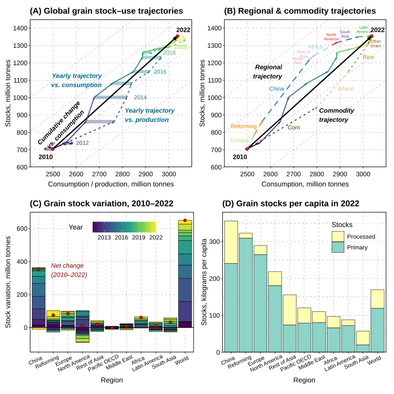
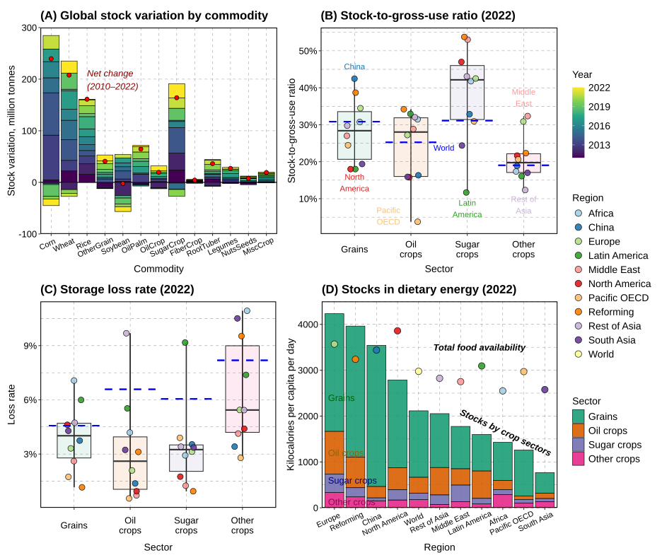
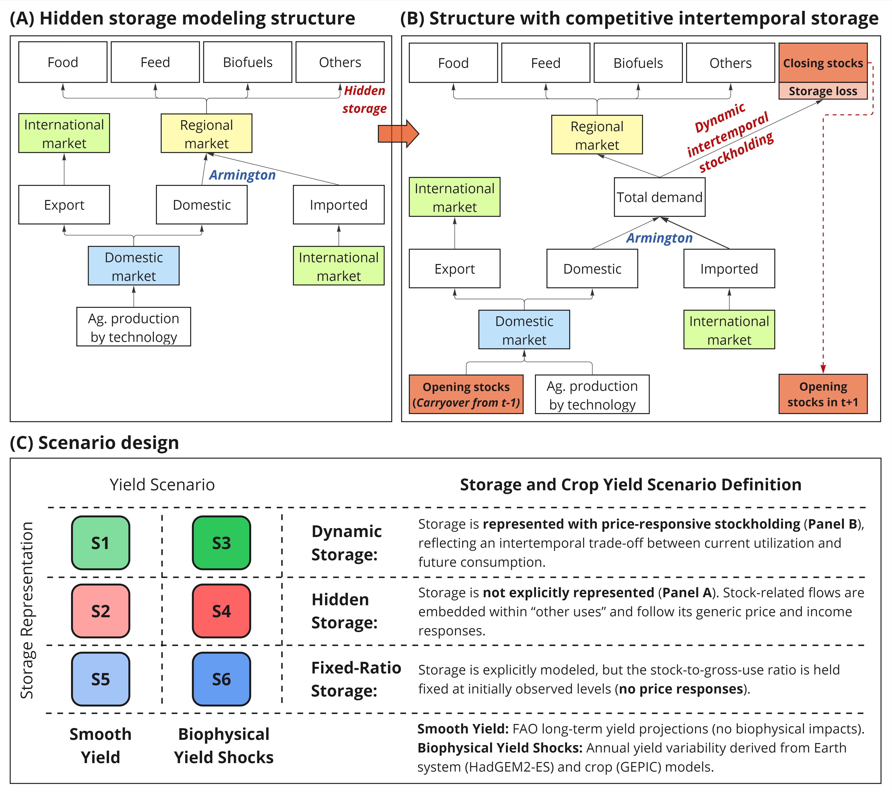
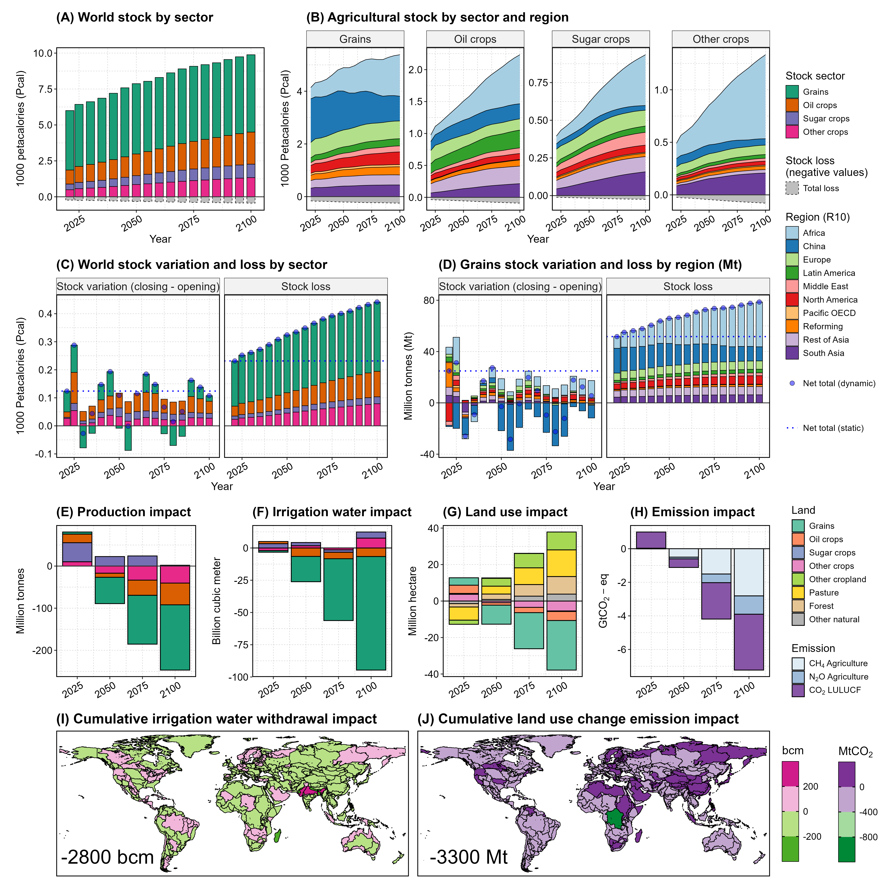
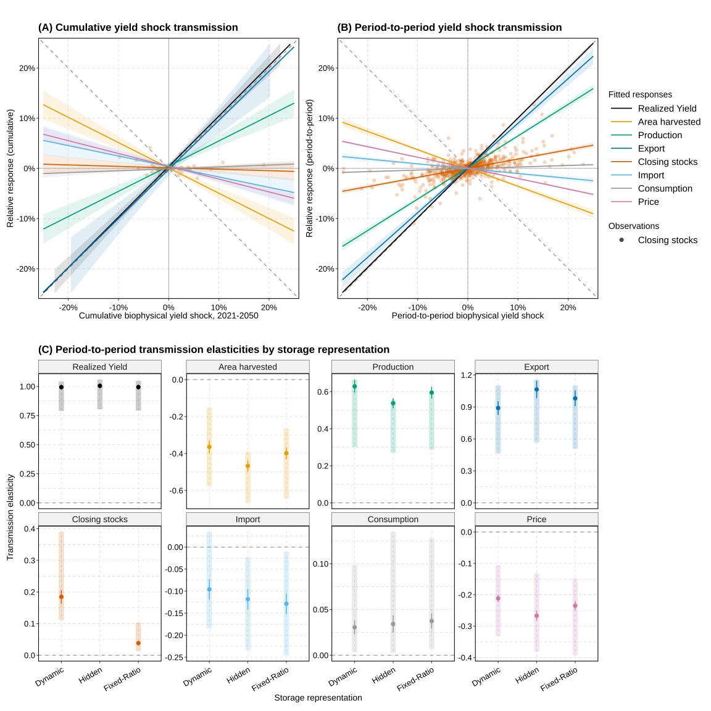

# Overview

This Repo includes the GCAM model and related files for replicating GCAM runs performed for the study. We integrated the processing code in the same repo (`input/gcamdata/paper`) for replicating the key figures used in the paper.

**Agricultural storage is a hidden demand driver and an overlooked temporal buffer in global agrifood system futures** (title at submission)  

Xin Zhao, Pralit L. Patel, Stephanie T. Morris, Ellie N. Lochner, Matthew T. Binsted, Katherine V. Calvin, Thomas B. Wild, James A. Edmonds, Marshall A. Wise

Joint Global Change Research Institute, Pacific Northwest National Laboratory, 5825 University Research Ct, College Park, MD 20740, USA
Corresponding Author: Xin Zhao | xin.zhao@pnnl.gov 

Research Square Preprint [Link](https://www.researchsquare.com/article/rs-11155420/) 

https://www.researchsquare.com/article/rs-11155420/v1

**The model was built based on [GCAM v9.1](https://jgcri.github.io/gcam-doc/toc.html) and includes data and assumption changes, which are documented in the paper.**


## R Session Information (renv used for gcamdata but not updated for the visulaization repo)
```
R version 4.6.0 (2026-04-24 ucrt)
Platform: x86_64-w64-mingw32/x64
Running under: Windows 11 x64 (build 26200)

Matrix products: default
  LAPACK version 3.12.1

locale:
[1] LC_COLLATE=English_United States.utf8  LC_CTYPE=English_United States.utf8    LC_MONETARY=English_United States.utf8
[4] LC_NUMERIC=C                           LC_TIME=English_United States.utf8    

time zone: America/New_York
tzcode source: internal

attached base packages:
[1] stats     graphics  grDevices utils     datasets  methods   base     

other attached packages:
 [1] cowplot_1.2.0      ggnewscale_0.5.2   ggtext_0.1.2       lemon_0.5.2        circlize_0.4.18    RColorBrewer_1.1-3 patchwork_1.3.2   
 [8] purrr_1.2.2        scales_1.4.0       ggsci_5.0.0        ggplot2_4.0.3      stringr_1.6.0      tidyr_1.3.2        dplyr_1.2.1       
[15] gcamdata_8.2       testthat_3.3.2    

loaded via a namespace (and not attached):
 [1] tidyselect_1.2.1    viridisLite_0.4.3   farver_2.1.2        filelock_1.0.3      S7_0.2.2            fastmap_1.2.0      
 [7] digest_0.6.39       base64url_1.4       lifecycle_1.0.5     ellipsis_0.3.3      magrittr_2.0.5      compiler_4.6.0     
[13] rlang_1.2.0         progress_1.2.3      tools_4.6.0         igraph_2.3.2        utf8_1.2.6          data.table_1.18.4  
[19] knitr_1.51          prettyunits_1.2.0   labeling_0.4.3      bit_4.6.0           pkgbuild_1.4.8      plyr_1.8.9         
[25] xml2_1.5.2          pkgload_1.5.3       withr_3.0.2         desc_1.4.3          grid_4.6.0          colorspace_2.1-2   
[31] cli_3.6.6           crayon_1.5.3        ragg_1.5.2          generics_0.1.4      otel_0.2.0          rstudioapi_0.19.0  
[37] storr_1.2.6         tzdb_0.5.0          commonmark_2.0.0    sessioninfo_1.2.4   cachem_1.1.0        assertthat_0.2.1   
[43] parallel_4.6.0      vctrs_0.7.3         devtools_2.5.2      litedown_0.9        hms_1.1.4           bit64_4.8.2        
[49] systemfonts_1.3.2   glue_1.8.1          stringi_1.8.7       gtable_0.3.6        shape_1.4.6.1       tibble_3.3.1       
[55] pillar_1.11.1       brio_1.1.5          txtq_0.2.4          R6_2.6.1            textshaping_1.0.5   rprojroot_2.1.1    
[61] vroom_1.7.1         evaluate_1.0.5      drake_7.13.11       lattice_0.22-9      markdown_2.0        readr_2.2.0        
[67] backports_1.5.1     gridtext_0.1.6      memoise_2.0.1       Rcpp_1.1.1-1.1      svglite_2.2.2       gridExtra_2.3      
[73] xfun_0.58           fs_2.1.0            usethis_3.2.1       pkgconfig_2.0.3     GlobalOptions_0.1.4
```

# Processing of Display Items

The data processing and visualization repo is integrated in the GCAM repo in [input/gcamdata/paper](./input/gcamdata/paper) and the processed output are stored in [input/gcamdata/paper/output](./input/gcamdata/paper/output).

To replicate the processing:
1. Load `gcamdata` (`devtools::load_all()`) and run `driver_drake()`. This is need for generating XMLs needed for running GCAM scenarios. More importantly here, historical data needed are stored in the drake cache once drake is completed. 
2. Download the queried and saved RDS GCAM scenario outcome data (`GCAM_queries_MainScenarios.rds`) from [zenodo] (`https://zenodo.org/records/23611035`) and place it in [input/gcamdata/paper/cache](./input/gcamdata/paper/cache). Users can also query and process those data if the scenario Databases were available (see code in `R/Results_1_Database.R`)
3. Run [input/gcamdata/paper/main.R](./input/gcamdata/paper/main.R). The detailed processing scripts are stored in the `R` folder but sourced in `main.R`.


## Key Figures
 
**Fig. 1 | Global and regional patterns of cereal grain stocks and stock variation.** **Panel A**, Global grain stock–use trajectories. The black arrow shows the cumulative shift from 2010 to 2022. The solid trajectory plots annual global grain stocks against consumption, whereas the dotted trajectory plots stocks against production; colors indicate year. At the global level, net trade sums to zero, so the horizontal separation between the production and consumption trajectories represents annual stock variation. Grey diagonal lines are slope-one guides. **Panel B**, Regional and commodity decomposition of the global grain trajectory. Dashed paths decompose the cumulative 2010–2022 shift by IPCC R10 regions, whereas dotted paths decompose it by GCAM cereal grain commodities (Corn, Wheat, Rice, and OtherGrain). Each path begins at the 2010 global point and sequentially adds regional or commodity contributions to reach the common 2022 endpoint. **Panel C**, Annual grain stock variation by region. Colored bar segments show annual net changes in grain stocks from 2010 to 2022; positive values indicate stock accumulation and negative values indicate stock drawdown. Red points show the cumulative net stock change over 2010–2022. **Panel D**, Grain stocks per capita in 2022 by region. Stacked bars partition closing stocks between primary grain commodities and processed grain products. Stock variation denotes the net change between opening and closing stocks in annual food balance sheets; stock levels are based on closing stocks. All mass quantities are expressed in primary-equivalent units. Commodity and region mappings are provided in Supplementary Tables 3 & 4. Data sources: FAOSTAT and gcamfaostat. 

 
**Fig. 2 | Agricultural stock variation and stock-related metrics.** **Panel A**, Global stock variation by GCAM storable crop commodity, excluding vegetables and fruits, over 2010–2022. Colored bar segments show annual net stock changes, and red points show the net cumulative stock change over 2010–2022. **Panels B & C**, Stock-to-gross-use ratios (B) and Storage loss rates (C) in 2022 by crop sector. In both panels, boxplots show the median, interquartile range (25th–75th percentiles; boxes), and full IPCC R10 regional range (whiskers); colored points show regional values; and blue dashed lines indicate world averages by sector. Stock-to-gross-use ratio is defined as net closing stocks divided by gross domestic use, comprising current domestic utilization, net closing stocks, and storage-associated losses. Storage loss rates are derived based on food-balance-sheet post-harvest loss-related estimates. **Panel D**, Regional crop stocks in dietary-energy terms in 2022. Stacked bars show closing stock levels by crop sector, converted to kilocalories per capita per day. Points show total food availability (utilization), including all food commodities, for comparison. Mass-based quantities and ratios are derived from food balance sheets expressed in primary-equivalent units. The Supplementary Information provides region, sector, and commodity mappings, along with additional details. Data sources: FAOSTAT and gcamfaostat.

 
**Fig. 3 | Modeling structure and scenario design.** **Panel A** shows the regional agricultural market structure under Hidden Storage, in which stock-related flows remain embedded within “other uses” and stocks are not separately tracked across model periods. **Panel B** shows Dynamic Storage, which explicitly links opening stocks, closing stocks, and storage-associated losses across periods. Panel C summarizes the six scenarios combining Dynamic, Hidden, and Fixed-Ratio Storage with smooth and biophysically shocked yield trajectories. S1 and S2 are the smooth-yield Dynamic and Hidden scenarios; S3 and S4 apply common biophysical yield shocks under Dynamic and Hidden Storage; and S5 and S6 are the corresponding Fixed-Ratio scenarios. See Methods for details on scenario description.

 
**Fig. 4 | Global agricultural storage dynamics and multisectoral impacts.** Panels A–B show projected agricultural closing stocks toward the end of the century for crop sectors with explicit storage representation in GCAM, by sector and by sector–region combination, based on GCAM projections from the reference scenario S1, with total storage-associated losses shown as negative values (grey). Panels C–D decompose storage dynamics into net stock variation (closing minus opening stocks) and storage losses, shown globally by sector in dietary energy units (Panel C) and for grains by region in million tonnes (Panel D), respectively. Points denote totals under dynamic competitive storage modeling, while dotted lines show constant-initial-value benchmarks. Panels E–H show global multisectoral impacts of explicit storage representation, quantified as differences between the competitive storage scenario (S1) and the hidden storage scenario (S2), including effects on agricultural production, irrigation water withdrawals, land use change, and cumulative emissions (from 2021 to the displayed horizons) from agricultural CH4 and N2O, and land use change CO2 (LULUCF). Panels I–J show the spatial distribution of cumulative irrigation water withdrawal impacts (aggregated across all crops) and cumulative LULUCF emissions, respectively, at the river-basin scale. Data source: GCAM simulation results. 


 
**Fig. 5 | Storage dynamics alter the transmission of biophysical yield shocks.** **Panel A**, Cumulative transmission from 2021 to 2050 under Dynamic Storage. Lines show ordinary least-squares fits with an intercept between cumulative biophysical yield shocks and responses in realized yield, harvested area, production, export, closing stocks, import, total consumption, and price; shaded bands indicate 95% confidence intervals for the fitted mean relationships. For visual comparability, both axes are restricted to −25% to +25%; confidence bands extending beyond these limits are clipped. **Panel B**, Period-to-period transmission under Dynamic Storage, pooled across successive GCAM model-period transitions from 2021 to 2100. Lines and 95% confidence bands show the corresponding fitted relationships. In Panels A and B, individual observations are shown only for closing stocks to highlight the intertemporal storage response; grey dashed diagonals indicate unit-elastic positive and negative transmission. Panel C, Period-to-period transmission elasticities under Dynamic, Hidden, and Fixed-Ratio Storage. Points and narrow bars show pooled OLS estimates and 95% confidence intervals, consistent with the fitted relationships in Panel B; wide translucent bars show the interquartile range of slopes estimated for individual region–crop markets, indicating cross-market heterogeneity. Closing stocks denote net inventories remaining after storage-associated loss. Consumption denotes aggregate current domestic consumption and excludes closing stocks and storage-associated losses. Hidden Storage does not report explicit closing stocks. Complete cumulative and period-to-period results are provided in Supplementary Figs. 14–19. Supplementary Table 7 reports coefficient estimates and cross-market heterogeneity summaries; Supplementary Table 8 reports pairwise tests of transmission coefficients across storage representations; and Supplementary Table 9 reports fixed-effect robustness results.


---
Original README from GCAM
---
# Global Change Analysis Model (GCAM)

The Joint Global Change Research Institute (JGCRI) of the Pacific 
Northwest National Laboratory (PNNL) is the home and primary 
development institution for GCAM, a multisector model for exploring 
consequences of and responses to global to local changes and stressors. 
Regional energy, water, land, and economic systems are connected to the
rest of the globe through trade and interactions with environmental systems.
These systems are also connected with each other.
Multisector models such as GCAM capture these 
interconnected impacts in an economic framework in order to explore 
these dynamic interactions and feedbacks between regions and sectors.

GCAM has been developed at PNNL-JGCRI for over 20 years and is a freely
available community model and documented online (See below). The team
at JGCRI is comprised of physical scientists, engineers, economists, energy
experts, forest ecologists, agricultural scientists, and environmental system
scientists who develop the model and apply it to a range of research questions.
The JGCRI team works closely with the developers of other Earth system and
ecosystem models to integrate the effects of human actions modeled in GCAM
into their research.

## Model Overview

GCAM is a dynamic-recursive model with technology-rich representations
of the economy, energy sector, land use, and water linked to a reduced complexity
Earth system model that can be used to explore many science and decision-relevant
questions including the effects of changes in trade patterns, critical minerals
& materials availability, and deployment of energy technologies on human and
Earth systems. Regional population and labor productivity growth assumptions
drive the energy and land-use systems, employing numerous technology options to
produce, transform, and provide energy services, as well as to produce
agriculture and forest products, and to determine land use and land cover.
Using a run period extending from 1990 – 2100 (historical years through 2021)
with annual results computed at 1-5 year intervals, GCAM has been used to
explore the potential role of emerging energy supply technologies and
the consequences of specific measures or energy technology adoption, including
bioenergy; critical minerals & materials; hydrogen systems; nuclear energy;
renewable energy technologies; carbon capture, storage, and utilization and
energy use technology in buildings, industry, and the transportation
sectors. GCAM outputs include projections of future energy and critical mineral
supply, trade, and demand and the resulting radiative forcing and other effects
of 16 greenhouse gases, aerosols, and short-lived species at 0.5×0.5 degree
resolution, contingent on assumptions about future population, economy, technology,
trade and other polices.

## Community guidelines for peer-reviewed journal articles using GCAM

This section outlines some suggested language which the GCAM user community 
can employ to describe GCAM in papers in peer-reviewed journal articles,
reports, or other public documents using GCAM or versions of GCAM. GCAM is
under continuous development. The suggested language for the opening paragraphs
of a methodology or introduction section of a paper describing GCAM is as
follows:

"The Global Change Analysis Model (GCAM) is a multisector model developed and maintained at the Pacific Northwest National Laboratory’s Joint Global Change Research Institute (JGCRI, 2023) _\<include additional citations to previous GCAM studies as relevant\>_. GCAM is an open-source community model. In this study, we use GCAM v NN. The documentation of the model is available at the GCAM documentation page ([http://jgcri.github.io/gcam-doc](http://jgcri.github.io/gcam-doc)) and the description below is a summary. GCAM includes representations of: economy, energy, agriculture, and water supply in 32 geopolitical regions across the globe; their GHG and air pollutant emissions and global GHG concentrations, radiative forcing, and temperature change; and the associated land allocation, water use, and agriculture production across 396 land sub-regions and 235 water basins.  _\<If using GCAM-USA, include without quotes: "This study uses a U.S.-focused version of GCAM called GCAM-USA that includes representation of energy, economy, and water systems for the fifty states and the District of Columbia in addition to 31 regions outside of the United States.”\>_. The version of GCAM used in this study is available – along with full source code and instructions for use – in a public repository _\<include citation including link to the GCAM repository with doi used in paper\>_. 

Subsequent paragraphs of the description might expound on particular capabilities, systems, or sectors of focus in the paper. Details in the GCAM documentation page can be used as a reference to develop these paragraphs.

Community users of GCAM might also undertake their own model developments and/or assumptions for papers. It is recommended that these departures from the publicly available version of the model be clearly described. In addition, if these developments are substantial, we suggest making this clear by including an additional phrase (e.g. region name or name of institution) in the name of the model and explicitly calling it out in place of or immediately following the italicized portion in the above paragraphs. For example: _"This study uses a modified version of GCAM/GCAM-USA called GCAM-\<institution name\>/GCAM-USA-\<institution name\>. GCAM-\<institution name\>/GCAM-USA-\<institution name\> incorporates additional details and modified assumptions from GCAM v NN as described subsequently"_. 

## Documentation

* [GCAM Documentation](http://jgcri.github.io/gcam-doc/)
* [Getting Started with GCAM](http://jgcri.github.io/gcam-doc/user-guide.html)
* [GCAM Community](https://gcims.pnnl.gov/community)
* [GCAM Videos and Tutorial Slides](https://gcims.pnnl.gov/community)
* [GCAM Citation and Co-authorship Guidelines](http://jgcri.github.io/gcam-doc/community-guide.html)

## Selected Publications

Calvin, K., Patel, P., Clarke, L., Asrar, G., Bond-Lamberty, B., Cui, R. Y., Di Vittorio, A., Dorheim, K., Edmonds, J., Hartin, C., Hejazi, M., Horowitz, R., Iyer, G., Kyle, P., Kim, S., Link, R., McJeon, H., Smith, S. J., Snyder, A., Waldhoff, S., and Wise, M.: GCAM v5.1: representing the linkages between energy, water, land, climate, and economic systems, Geosci. Model Dev., 12, 677–698, https://doi.org/10.5194/gmd-12-677-2019, 2019.

Edmonds, J., and J. Reilly (1985)Global Energy: Assessing the Future (Oxford University Press, New York) pp.317.

Edmonds, J., M. Wise, H. Pitcher, R. Richels, T. Wigley, and C. MacCracken. (1997) “An Integrated Assessment of Climate Change and the Accelerated Introduction of Advanced Energy Technologies”, Mitigation and Adaptation Strategies for Global Change, 1, pp. 311-39

Kim, S.H., J. Edmonds, J. Lurz, S. J. Smith, and M. Wise (2006) “The ObjECTS Framework for Integrated Assessment: Hybrid Modeling of Transportation ” Energy Journal (Special Issue #2) pp 51-80.

[Full list of GCAM publications](http://jgcri.github.io/gcam-doc/references.html)
